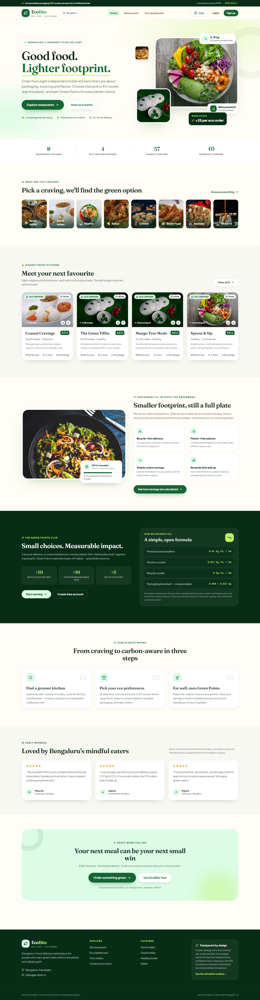
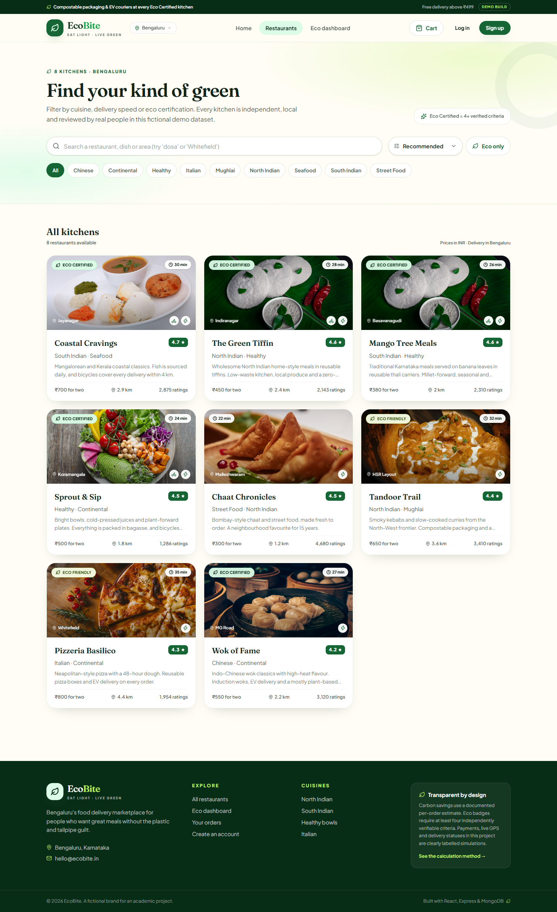
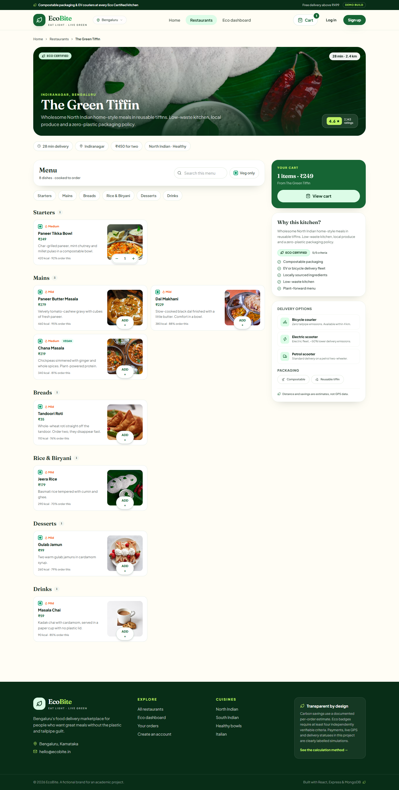
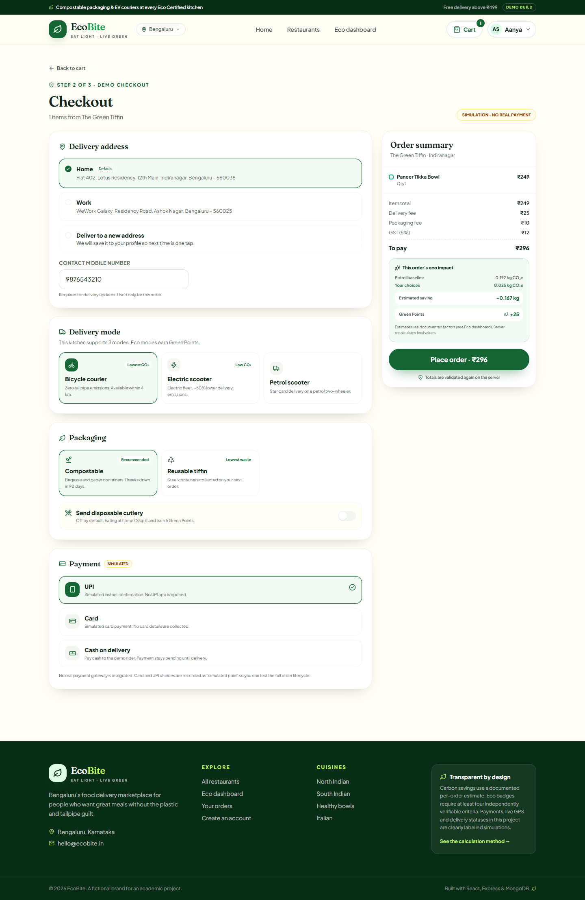
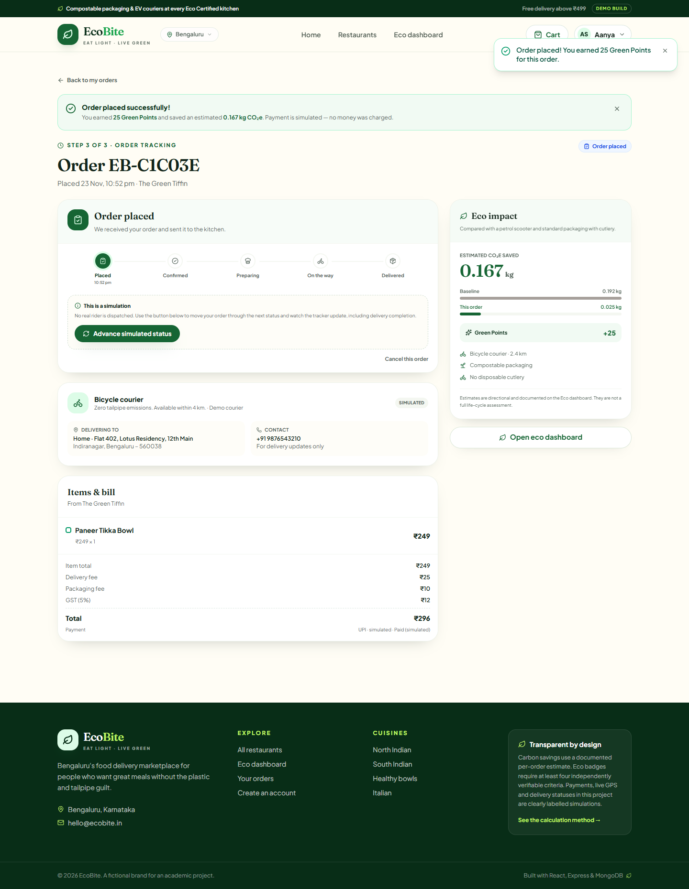
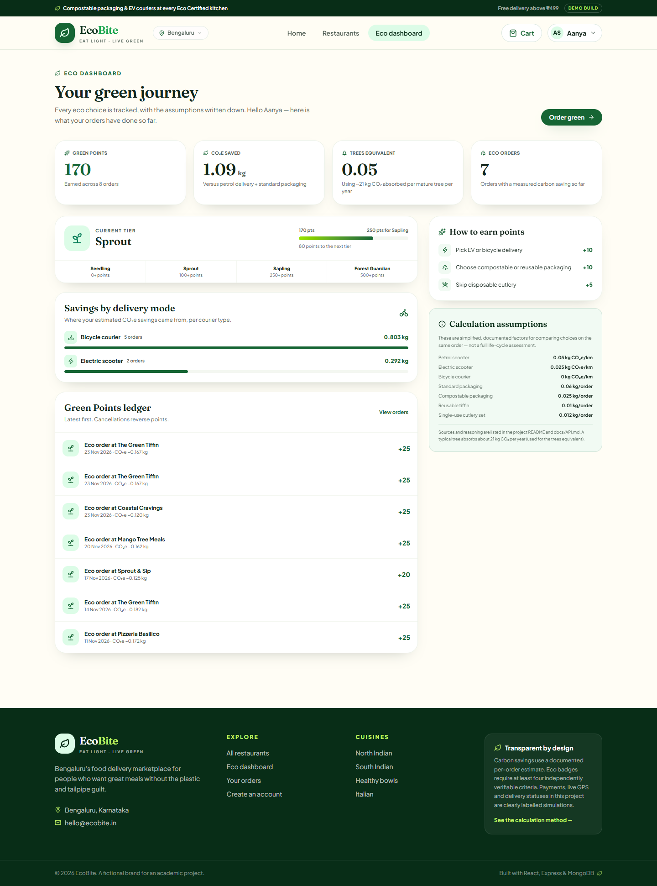
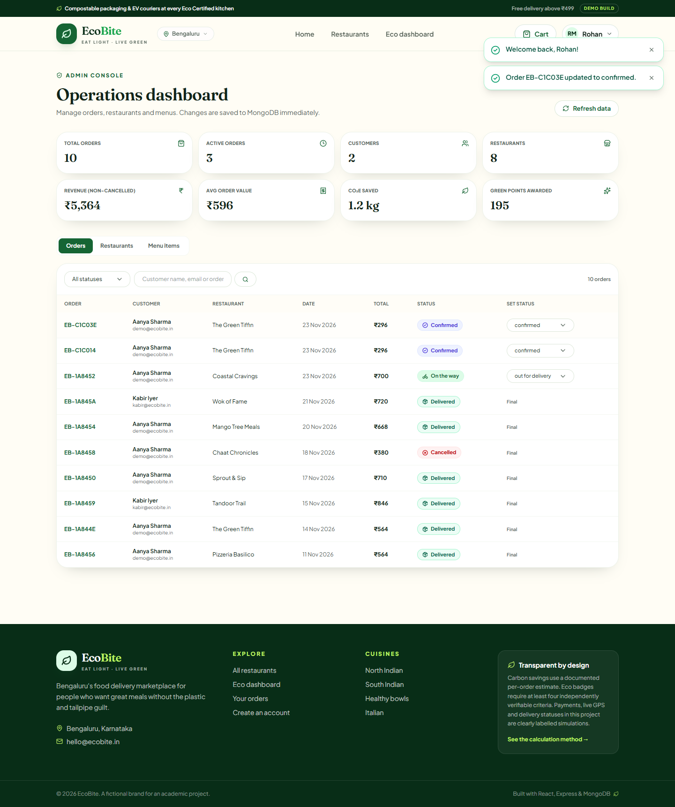

# EcoBite — Eco-friendly food delivery platform

**Software Development Fundamentals — project report**

| | |
| --- | --- |
| Student | _[Your name]_ |
| Roll number | _[Your roll number]_ |
| Course / section | _[Course code and section]_ |
| Submitted | 23 November 2026 |
| Repository | `ecobite/` (React + Express + MongoDB) |

---

## 1. Abstract

EcoBite is a working full-stack food delivery application for Bengaluru that makes the environmental
cost of an order visible before checkout. Customers order from eight independent kitchens, choose a
bicycle or EV courier and compostable or reusable packaging, and earn Green Points for measurable
lower-carbon choices. Unlike a UI mock-up, every screen is connected to a REST API backed by MongoDB:
accounts, carts, orders, simulated payments, order tracking, rewards and the admin console all persist
real data. Bills and carbon savings are computed on the server, so prices and eco claims cannot be
altered from the browser. The build is verified by 43 automated backend tests and a scripted
end-to-end browser run that captured the screenshots in this report.

## 2. Problem statement

Food delivery apps optimise for speed and discounts; packaging waste, cutlery and delivery emissions
are hidden from the customer. Users who want a lower-impact meal cannot easily compare a bicycle
courier with a petrol scooter, or a reusable tiffin with a plastic container. Restaurants that invest
in eco practices have no simple way to be recognised for them. Existing demos of delivery apps are
usually frontend-only and cannot demonstrate real order, inventory, role or validation behaviour.

## 3. Objectives

1. Build a complete, runnable MERN application — not a static prototype — with authentication,
   persistent cart and server-verified checkout.
2. Let customers choose delivery mode, packaging and cutlery, and show the CO₂e difference and Green
   Points before they pay.
3. Provide an Eco dashboard with documented assumptions, tier progress and a rewards ledger.
4. Give admins tools to manage order status, restaurants and menu items with role-based permissions.
5. Apply secure practices: hashed passwords, JWT sessions, RBAC, input validation, rate limiting and
   clean error responses.
6. Verify quality with automated tests and a real browser walkthrough, and document setup and APIs.

## 4. Stakeholders

| Stakeholder | Interest |
| --- | --- |
| Customer | Fast ordering, transparent prices, eco choices, order history and rewards |
| Restaurant partner | Menu management, incoming orders, visible eco certification |
| Admin / operations | Order pipeline, catalogue control, revenue and impact overview |
| Project evaluator | Working features, clean architecture, test evidence, honest limitations |
| Society / environment | Reduced single-use packaging and delivery emissions |

## 5. Requirements

### 5.1 Functional requirements

| ID | Requirement | Implemented in |
| --- | --- | --- |
| FR1 | Register, log in and persist a JWT session | `/api/auth`, `AuthContext`, Login/Signup pages |
| FR2 | Browse and filter restaurants by search, cuisine, eco badge and sort order | `GET /api/restaurants`, Restaurants page |
| FR3 | View a menu with veg filter, search, categories and availability | `GET /api/restaurants/:slug`, Menu page |
| FR4 | Cart limited to one kitchen, with quantity controls and persisted state | `CartContext`, Cart page |
| FR5 | Checkout with saved/new address, phone, delivery mode, packaging, cutlery and payment | `POST /api/orders`, Checkout page |
| FR6 | Server calculates item prices, delivery, packaging, 5% GST and eco impact | `utils/pricing.js`, `utils/eco.js` |
| FR7 | Simulated payment and step-by-step order tracking; cancellation reverses rewards | `/api/orders/:id/advance`, `/cancel` |
| FR8 | Green Points ledger, tier progress and lifetime CO₂e savings | `GET /api/rewards/summary`, Eco dashboard |
| FR9 | Profile with editable details, address book and order history | `/api/users/me`, Profile page |
| FR10 | Admin dashboard: stats, order status changes, restaurant/menu CRUD | `/api/admin/*`, admin routes |

### 5.2 Non-functional requirements

| ID | Requirement | How it is met |
| --- | --- | --- |
| NFR1 | Security | bcrypt (cost 12), JWT, RBAC, Helmet CSP, CORS allow-list, Zod validation, operator-injection sanitisation, rate limits |
| NFR2 | Data integrity | Server-authoritative totals; items must belong to the restaurant; quantity and enum checks |
| NFR3 | Usability | Responsive layout (390 px to 1440 px), clear simulated-payment labels, accessible focus states, reduced-motion support |
| NFR4 | Performance | Indexed Mongo queries, paginated orders/rewards, lazy-loaded images, Vite production build |
| NFR5 | Maintainability | npm workspaces, layered server folders, shared constants, seeded demo data, documented API |
| NFR6 | Testability | 43 Vitest + Supertest tests against an isolated in-memory MongoDB; repeatable browser script |

## 6. Design

### 6.1 Architecture

```text
React SPA (Vite, :5173)
  pages / contexts / components
        │  JSON over /api (dev proxy)
        ▼
Express API (:5000)
  routes → middleware (auth, validation, rate limits)
        → services (orders, eco, pricing) → Mongoose
        ▼
MongoDB (:27017)  User · Restaurant · MenuItem · Order · Reward
```

In development Vite proxies `/api` to the Express server. For deployment, `npm run build` writes
`client/dist` and Express serves the SPA and the API from one origin.

### 6.2 Data model

| Collection | Key fields | Relationships |
| --- | --- | --- |
| User | name, email (unique), passwordHash, phone, addresses[], greenPoints, lifetimeSavingsKg, role | referenced by orders and rewards |
| Restaurant | name, slug (unique), cuisines[], area, image, rating, deliveryModes[], packagingOptions[], isEcoCertified, isActive | one-to-many menu items/orders |
| MenuItem | name, price, category, isVeg, spiceLevel, available, popularity | belongs to one restaurant |
| Order | orderCode, items snapshot, totals, address snapshot, deliveryMode, packaging, eco metrics, statusHistory[], paymentStatus | belongs to user and restaurant |
| Reward | type, points, co2SavedKg, description | belongs to user and order |

Order items copy name, price and image at purchase time, so later menu edits do not rewrite history.

### 6.3 Server-authoritative calculations

The client sends only item ids, quantities and preferences. The server reloads menu prices, validates
restaurant support for the chosen mode/package, and computes the bill and eco impact:

```js
// server/src/utils/pricing.js
const itemTotal = items.reduce((sum, i) => sum + i.price * i.quantity, 0);
const deliveryFee = itemTotal >= 499 ? 0 : 25;
const taxes = Math.round(itemTotal * 0.05);
return { itemTotal, deliveryFee, packagingFee: 10, taxes,
         total: itemTotal + deliveryFee + 10 + taxes };
```

```js
// server/src/utils/eco.js (condensed)
baseline = km * 0.05 + 0.06 + 0.012;          // petrol scooter, standard pack, cutlery
actual   = modeCost(km) + packKg + (cutlery ? 0.012 : 0);
co2Saved = Math.max(0, baseline - actual);     // rounded to 3 decimals
points   = (mode !== 'standard' ? 10 : 0) + (pack !== 'standard' ? 10 : 0)
         + (!cutlery ? 5 : 0);
```

Values are documented estimates for comparing options on a single order, not a lifecycle study.

## 7. Implementation highlights

- **Authentication and roles.** Passwords are hashed with bcrypt; tokens carry only user id and role.
  `protect` verifies the token, `adminOnly` enforces RBAC on admin routes. All password hashes are
  stripped before serialisation.
- **Validation.** Zod schemas cover registration, addresses, restaurants, menu items and orders.
  Failures return `400` with `{ field, message }` entries that the forms display inline.
- **Order lifecycle.** `placed → confirmed → preparing → out_for_delivery → delivered`, with history
  timestamps. Delivery and cancellation are guarded (no cancelling a delivered order; cancelling
  reverses Green Points and records a negative ledger row).
- **Eco transparency.** Assumptions are returned by `/api/rewards/summary` and shown on the Eco
  dashboard and checkout preview, matching the server exactly.
- **Admin console.** Plain tables (no chart library): stat cards, inline order-status selects,
  restaurant/menu create-edit modals, and a delete guard for restaurants with order history (`409`).
- **Failure handling.** Global error middleware converts Mongoose, JWT and JSON parse errors into the
  same JSON shape; the client shows toasts and retry states instead of silent failures.

## 8. Screenshots

All screenshots were captured on 23 November 2026 from the running application in real Chrome
(Playwright, headless) — no mock-ups. The script logged in with seeded accounts, added a dish, placed
an order, advanced its simulated status and exercised the admin console. The browser reported **zero
console or page errors** across the run. Eight key screens are shown here; the remaining captures
(cart, login, signup, profile, menu admin, tracking progress) are in `docs/screenshots/`.

| Home — value proposition, eco stats, kitchens | Restaurants — search, cuisine and eco filters |
| --- | --- |
|  |  |
| *Fig. 1. Home page with green-points explainer.* | *Fig. 2. Eight seeded kitchens with ratings and badges.* |

| Menu — hero, veg filter, cart total | Checkout — address, mode, packaging, simulated payment |
| --- | --- |
|  |  |
| *Fig. 3. Green Tiffin menu; eco sidebar; quantity stepper.* | *Fig. 4. Bicycle courier + compostable packaging + no cutlery.* |

| Order tracking — simulated status and eco receipt | Eco dashboard — tiers, savings by mode, ledger |
| --- | --- |
|  |  |
| *Fig. 5. Placed order: ₹296 total, 0.167 kg CO₂e saved, +25 points.* | *Fig. 6. Lifetime impact and documented assumptions.* |

| Admin — orders and status control | Mobile home (390 px) |
| --- | --- |
|  |  |
| *Fig. 7. Live stats, status selects, search by customer.* | *Fig. 8. Responsive layout on a phone viewport.* |

The admin console also exposes a restaurants tab (eco criteria, activation) and a menu-items tab.

## 9. Testing and results

**Environment.** Windows 11 (10.0.26300), Node.js 24.22.1, MongoDB 8.0.4, Vitest 5 + Supertest,
mongodb-memory-server; headless Chrome via Playwright for the end-to-end run.

### 9.1 Automated backend suite — actual run

Command: `npm test` (5 files, isolated in-memory MongoDB).

| File | Focus | Tests | Result |
| --- | --- | --- | --- |
| `auth.test.js` | Registration, login, session, profile/addresses | 8 | 8 passed |
| `catalog.test.js` | Restaurant search/filter/sort, menus, admin CRUD, RBAC | 10 | 10 passed |
| `orders.test.js` | Placement, server totals, ownership, tracking, cancellation, rewards | 11 | 11 passed |
| `eco.test.js` | Eco model, points, tiers, pricing maths | 6 | 6 passed |
| `security.test.js` | Health, Helmet, JSON errors, tokens, RBAC, 404, injection | 8 | 8 passed |
| **Total** | | **43** | **43 passed (0 failed), 20.1 s** |

### 9.2 Representative test cases (observed results)

| ID | Case / input | Expected | Actual result | Status |
| --- | --- | --- | --- | --- |
| T1 | Register valid customer | `201`, token, no password hash | `201`; token issued; hash absent | Pass |
| T2 | Register duplicate email | `409` conflict | `409` "account ... already exists" | Pass |
| T3 | Weak password `abc` | `400` + field error | `400` with password message | Pass |
| T4 | Login with seeded demo account | `200` + token | `200`; user Aanya Sharma | Pass |
| T5 | Admin write as customer | `403` | `403`; admin write as admin succeeds | Pass |
| T6 | Unknown restaurant slug | `404` | `404` "Restaurant not found." | Pass |
| T7 | Delete restaurant with orders | `409` | `409`; deactivate suggested | Pass |
| T8 | Place order with tampered prices | Server totals used | Tampered totals ignored; ₹296 charged | Pass |
| T9 | Order with another restaurant's item | `400` | `400` "not on this restaurant menu" | Pass |
| T10 | Quantity 0 or 11 | `400` | `400` validation errors | Pass |
| T11 | Read another user's order | `403` | `403` "You cannot view this order." | Pass |
| T12 | Advance a bicycle order to delivered | Status history grows | Delivered; `deliveredAt` set | Pass |
| T13 | Cancel an eco order | Points reversed | Points and CO₂e reduced; ledger row added | Pass |
| T14 | Mongo operator injection in login | Sanitised input | `401`; no bypass | Pass |
| T15 | Invalid JSON body | `400`, clean message | `400` "invalid JSON" | Pass |

### 9.3 End-to-end browser verification

`node scripts/verify-ui.mjs` completed the following on the real build: browse home → filter
restaurants → open The Green Tiffin → add Paneer Tikka Bowl → open cart → visit signup page → log in
as customer → checkout (bicycle, compostable, no cutlery, demo UPI) → place order (`EB-CIC03E`,
₹296, +25 points, 0.167 kg CO₂e saved) → advance twice (confirmed → preparing) → Eco dashboard →
profile/order history → separate admin session → change an order to **confirmed** → restaurants and
menu tabs → mobile home. It produced 15 screenshots (eight shown above) and reported **no console or
page errors**. After the run the admin dashboard showed 10 orders (8 seeded + 2 verification orders),
and the updated status persisted in MongoDB.

## 10. Limitations and future work

- Payments and live courier tracking are simulations and are labelled as such.
- Carbon factors are simplified estimates for comparison, not ISO 14064/14067 accounting.
- One-city catalogue, one active kitchen per cart, no live courier assignment or geolocation.
- Menu photos are stock images, so a few dish photos are approximate.
- Future work: payment gateway sandbox, courier dispatch, restaurant-owner role, order email
  notifications, formal accessibility audit and TypeScript migration.

## 11. Conclusion

EcoBite meets its objective of being a complete rather than cosmetic delivery app. A customer can
register, order a real database-backed meal, see a server-verified eco receipt, track it, cancel it
and watch rewards change; an admin can manage the same data with enforced permissions. Security and
validation are applied at the API boundary, and the eco model is documented and exposed to users
instead of being marketing copy. The 43 passing tests and the scripted browser run provide evidence
for the claimed behaviour, while the limitations section separates the simulated parts from real
functionality.

## References

1. IPCC (2022). *Climate Change 2022: Mitigation of Climate Change*. Working Group III contribution
   to the Sixth Assessment Report. <https://www.ipcc.ch/report/ar6/wg3/>
2. IEA (2023). *Global EV Outlook 2023*. International Energy Agency.
   <https://www.iea.org/reports/global-ev-outlook-2023>
3. Central Electricity Authority (India). *CO₂ Baseline Database for the Indian Power Sector*
   (user guide; grid emission factor used as ≈0.71 kg CO₂/kWh). <https://cea.nic.in/>
4. Ministry of Environment, Forest and Climate Change (India). *Plastic Waste Management Rules,
   2016* (as amended). <https://cpcb.nic.in/>
5. OWASP Foundation. *OWASP Top 10 — 2021*. <https://owasp.org/Top10/>
6. Jones, M., Bradley, J., Sakimura, N. (2015). *RFC 7519: JSON Web Token (JWT)*. IETF.
   <https://www.rfc-editor.org/rfc/rfc7519>
7. MongoDB, Express, React and Vite official documentation: <https://www.mongodb.com/docs/>,
   <https://expressjs.com/>, <https://react.dev/>, <https://vite.dev/>
